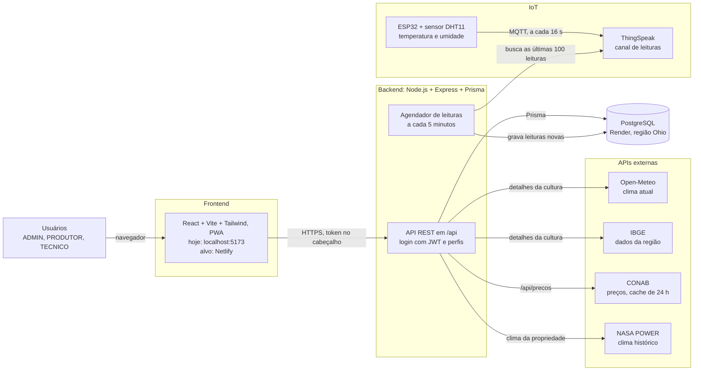

# Arquitetura do ValeSafra (1ª entrega)

Diagrama em Mermaid. O GitHub desenha sozinho quando este arquivo está no repositório.

## Como os dados andam

1. **Sensor até o banco:** o ESP32 publica temperatura e umidade no ThingSpeak por MQTT, a cada 16 segundos. O agendador do backend busca as últimas 100 leituras a cada 5 minutos, descarta as inválidas, ignora as que já existem e grava as novas no PostgreSQL.
2. **Banco até a tela:** o front pede os dados à API com o token de login. A API só devolve o que o perfil pode ver: o ADMIN vê tudo, e o PRODUTOR vê só as propriedades dele.
3. **Dados externos:** quando a tela de detalhes da cultura ou o clima da propriedade é aberto, a API consulta Open-Meteo, IBGE ou NASA. Os preços vêm da CONAB, com cache de 24 horas. Se uma API externa falhar, a tela recebe um aviso em vez de quebrar.

## Observações

- **Hoje tudo roda local** (1ª entrega). Netlify e Render são o destino planejado, e o banco já está no Render.
- O agendador deve rodar em **uma instância só**, para não buscar as mesmas leituras duas vezes.
- As credenciais (senha do banco, chave do JWT, chaves do ThingSpeak) ficam em variáveis de ambiente e não entram no repositório.
